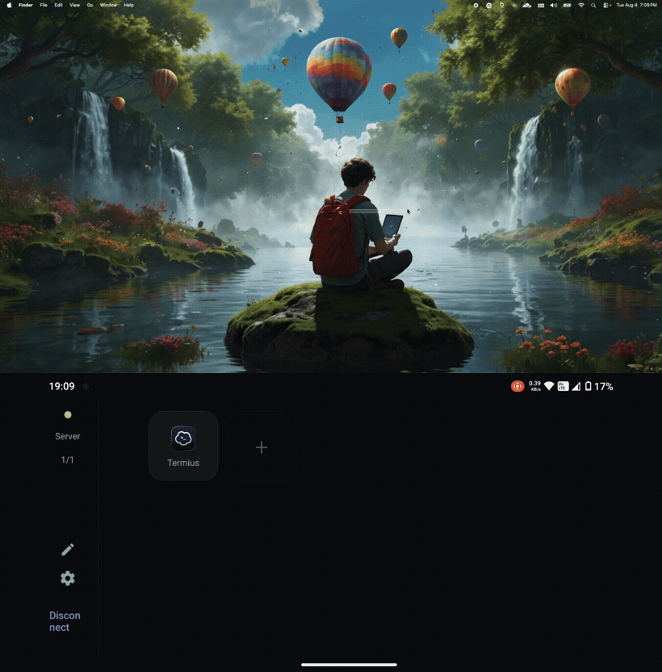
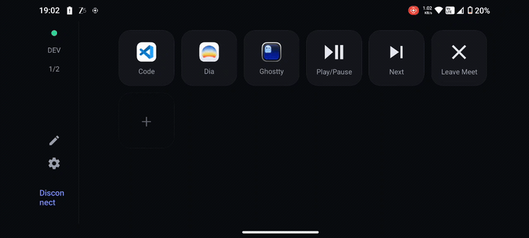
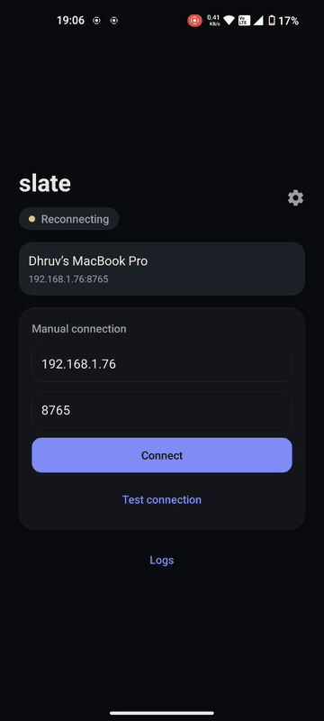
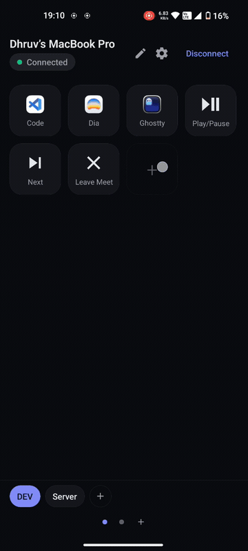

<div align="center">


# slate

**A programmable Stream Deck for your Mac, driven from your phone. Local network only - nothing leaves your Wi-Fi.**

[](https://www.apple.com/macos/)
[](#requirements)
[](https://expo.dev)
[](https://www.swift.org)
[](LICENSE)
[](https://github.com/vakharwalad23/slate/stargazers)
[](https://github.com/vakharwalad23/slate/releases/latest)

**slate v0.1.0 - first release is out.** [Download (macOS DMG + Android APK)](https://github.com/vakharwalad23/slate/releases/latest) | [Star the repo](https://github.com/vakharwalad23/slate/stargazers)

</div>

---

slate turns your phone into a programmable Stream Deck for a Mac. The phone shows a grid of
buttons; tapping one sends a command over a WebSocket on your LAN, and a small native macOS
menu-bar helper runs it on the Mac - launch or focus an app, run a macOS Shortcut or AppleScript,
send keystrokes, switch Spaces, control media, run multi-step macros, and more. Buttons render the
real macOS app icons, pulled live from the Mac. Local-network only, with secure pairing.

Built with React Native / Expo (one app for iOS and Android) and a native Swift menu-bar helper.

> [!NOTE]
> slate is local-network only. Traffic is **end-to-end encrypted** - a code-authenticated X25519
> handshake with ChaCha20-Poly1305, so the channel is sealed and man-in-the-middle fails closed
> without any TLS certificates. See [Security](#security).

## Demo

> Prefer one clip? Watch the [30-second walkthrough](docs/media/slate-demo.mp4).

The deck follows your foreground app - bind a deck to an app and it activates when that app comes
to the front. Here, opening the editor on the Mac swaps the phone from the **Server** deck to the
**DEV** deck automatically:

<p align="center"></p>

Tap a button to run a command on your Mac:

<p align="center"></p>

Pair by scanning a QR, then build any button - apps, Shortcuts, AppleScript, keystrokes, macros,
gestures:

<p align="center">
  
  &nbsp;&nbsp;
  
</p>

**New to slate?** The [user guide](docs/guide.md) walks through every feature, gesture, and chain
step by step - with diagrams.

## Why slate?

Most phone-as-deck apps route through a vendor cloud, lock you to one mobile platform, or show
generic icons. slate is local-network only - no account, no relay, nothing leaves your Wi-Fi - runs
on both iOS and Android from one codebase, and renders the real macOS app icons pulled live from
your Mac. The link is end-to-end encrypted; pairing is a QR you scan (or a code you type) plus a
per-device token you can revoke at any time.

## Features

- **Real macOS app icons, live.** Buttons show each Mac app's actual Finder icon, pulled live from
  the Mac and cached on the phone - not generic glyphs.
- **Local network only, no cloud.** Everything runs over your LAN via WebSocket. No account, no
  relay, nothing leaves your Wi-Fi.
- **End-to-end encrypted.** A code-authenticated X25519 handshake with ChaCha20-Poly1305 seals every
  frame over the LAN; scan the QR on the Mac (or type the code) to pair, plus a revocable per-device
  token, rate-limited with lockout. MITM fails closed, no TLS certificates.
- **iOS and Android.** One app, both platforms.
- **Portrait and a landscape dock mode.** Stand the phone sideways and it becomes a control surface
  with a side rail.
- **Light and dark theme.** Follow-system or manual.
- **Many actions per button.** Launch or focus an app, quit an app, run a macOS Shortcut (with input
  piped in), run AppleScript, send keystrokes, switch Spaces, cycle apps, control media and volume,
  run multi-step macros, or run guarded shell commands. Three icon sources per button - the Mac app
  icon, an emoji, or a built-in glyph - plus a sensible auto icon and label per action.
- **Per-button gestures.** Map a command to long-press, double-tap, or a swipe in any direction -
  e.g. double-tap to quit an app, swipe to change Spaces.
- **Pages and decks.** Multiple pages and multiple decks with a switcher; swipe to change page (two
  fingers to change deck), and drag-to-reorder buttons in edit mode.
- **Live profile switching.** The deck can follow the Mac's foreground app - bind an app to a deck and
  it activates automatically when that app comes to the front.
- **Auto-discovery and resilience.** Bonjour / mDNS plus a subnet scan find the Mac automatically
  (manual host:port always available); auto-reconnect with backoff, and it follows the Mac to a new
  IP after a network change.
- **A real menu-bar helper.** Server status, a scan-to-pair QR + code, paired-device list with revoke,
  a logs panel, a configurable port, and launch-at-login.

> New to slate? The **[user guide](docs/guide.md)** walks through every feature, option, and gesture
> step by step.

## How it works

```
   PHONE (the app)                 LAN                 MAC (the helper)
+---------------------+     WebSocket + JSON     +-------------------------+
|  React Native /     | <----------------------> |  Swift menu-bar app     |
|  Expo deck UI       |                          |  (NWListener server)    |
|  builds a Command   | --- command.execute ---> |  runs the macOS action  |
+---------------------+                          +-------------------------+
```

The app never calls OS logic directly - it builds a semantic `Command` and hands it to a transport,
so the backend stays pluggable behind a single interface.

## Project layout

A pnpm monorepo.

| Path | What |
| --- | --- |
| `apps/mobile` | Expo SDK 56 app (TypeScript) - the deck UI |
| `packages/protocol` | Shared TS types + JSON Schema - the wire contract |
| `packages/slate-discovery` | Expo module - Android UDP broadcast discovery |
| `helpers/mac-helper` | Swift menu-bar helper (the primary macOS backend) |
| `helpers/node-helper` | Node `ws` MVP helper (proves the loop; `launch_app` only) |
| `docs/` | Architecture, stack, code-logic, and flow docs |

## Requirements

- Node `>=22` (see `.node-version`) and pnpm `10.x`.
- macOS 14+ with Xcode and [XcodeGen](https://github.com/yonaskolb/XcodeGen) to build the Swift
  helper.
- For the phone app, an Expo dev build (Expo Go cannot load slate - it uses native modules):
  - iOS: Xcode + the iOS Simulator.
  - Android: Android Studio / a device, plus either EAS (cloud build) or a local native build.

## Install

Prebuilt downloads are on the [Releases page](https://github.com/vakharwalad23/slate/releases).

### macOS helper

Install with Homebrew (recommended) or from the DMG.

**Homebrew**

```sh
brew tap vakharwalad23/tap
brew trust vakharwalad23/tap    # one time: the cask runs a post-install step
brew install --cask slate-helper
```

`brew upgrade` keeps it current, and the quarantine flag is cleared for you.

**DMG**

1. Download `slate-helper-<version>.dmg`, open it, and drag **SlateHelper** onto **Applications**.
2. The helper is self-signed (not notarized), so macOS quarantines it on first launch. Clear the flag
   once, then open it normally:

   ```sh
   xattr -dr com.apple.quarantine /Applications/SlateHelper.app
   ```

Either way, SlateHelper runs in the menu bar (no Dock icon). To send keystrokes, switch Spaces, cycle
apps, or use media keys, enable it under System Settings -> Privacy and Security -> Accessibility;
launching apps and changing volume do not need it.

### Phone app (Android APK)

Download `slate-<version>.apk` from the same release, open it on your phone, and allow installing from
your browser or files app when prompted. iOS has no prebuilt download - build it on your own iPhone
with a free Apple ID: see [iOS on a physical iPhone](#ios-on-a-physical-iphone-free-apple-id-no-paid-account).

## Build and run from source

Prefer to build from source, or want to run on iOS? Follow the steps below; otherwise see
[Install](#install) for prebuilt downloads.

### 1. Clone and install

```sh
git clone https://github.com/vakharwalad23/slate.git
cd slate
pnpm install
```

### 2. Run the Mac helper

Option A - the Swift menu-bar app (recommended):

```sh
brew install xcodegen
cd helpers/mac-helper
xcodegen generate
open SlateHelper.xcodeproj
```

In Xcode, set Signing to your own team, then Build and Run (Cmd-R). The app has no Dock icon -
look for the menu-bar item. Allow the Local Network prompt on first connect. To send keystrokes,
switch Spaces, cycle apps, use media keys, or focus an app, enable SlateHelper under System Settings
-> Privacy and Security -> Accessibility; launching apps and changing volume do not need it.

Option B - the Node MVP helper (quick, `launch_app` only):

```sh
pnpm -F @slate/node-helper start    # ws://0.0.0.0:8765
```

### 3. Run the phone app

```sh
# iOS simulator (local)
pnpm -F @slate/mobile ios

# Android: build a dev client, then install it on a device
#   cloud build (no Android SDK needed):
eas build --profile preview --platform android
#   or a local native build (needs the Android SDK):
pnpm -F @slate/mobile android
```

#### iOS on a physical iPhone (free Apple ID, no paid account)

There is no prebuilt iOS download: slate has no paid Apple Developer Program behind it, so no
notarized, App Store, or TestFlight build. You can still install it on your own iPhone with a **free**
Apple ID using Xcode's free provisioning. The one catch is Apple's limit for free accounts - the app
stops launching about 7 days after it is signed, and you re-run it from Xcode to renew it.

1. Give the app a bundle id that is unique to you. In `apps/mobile/app.json`, change
   `ios.bundleIdentifier` from `com.slate.app` to something like `com.yourname.slate` - a free Apple ID
   cannot sign a bundle id already registered to another team.
2. Generate the native iOS project (this also runs `pod install`), then open the **workspace** - not
   the `.xcodeproj`:

   ```sh
   pnpm -F @slate/mobile prebuild
   open apps/mobile/ios/slate.xcworkspace
   ```
3. In Xcode: add your Apple ID under **Settings -> Accounts**, then select the `slate` target ->
   **Signing & Capabilities**, tick **Automatically manage signing**, and pick your name (Personal
   Team) as the Team.
4. Plug in your iPhone, select it as the run destination, and press **Run** (Cmd-R). The first launch
   is blocked until you trust the certificate: on the phone, **Settings -> General -> VPN & Device
   Management -> your Apple ID -> Trust**. Allow the Local Network prompt so slate can find your Mac.

Renewing: when slate refuses to open (~7 days later), reconnect the phone and press **Run** again to
re-sign it - no rebuild from scratch needed. A paid Apple Developer account removes the expiry and is
the only path to a shareable build (App Store / TestFlight / ad-hoc IPA); slate ships none today.

### 4. Pair and use

Open the app. It auto-discovers the helper (or enter host:port manually), then tap Pair and scan the
QR shown in the Mac menu (or type the code under it). Add buttons, pick an action and icon, and tap to
run them on the Mac.

Auto-discovery usually finds the Mac on its own (Android uses a UDP broadcast that answers in one
round trip); if it ever misses, type the IP shown in the Mac menu-bar helper into the host box.

## Security

slate is local-network only, and all application traffic is end-to-end encrypted over the existing
`ws://` transport. Pairing runs a code-authenticated X25519 handshake (the pairing code shown on the
Mac is mixed in as the pre-shared key), then ChaCha20-Poly1305 seals every frame - commands, the
bearer token, even ping/pong. The phone pins the helper's identity key at pairing, so reconnecting
needs no code and an impersonating helper fails closed. Pairing is rate-limited with lockout, and
devices are revocable from the helper. Full threat model, handshake spec, and key schedule:
[docs/security.md](docs/security.md).

## Development

```sh
pnpm check                       # Biome: format + lint + import sort
pnpm -F @slate/mobile type-check # TypeScript
pnpm -F @slate/node-helper test  # Node helper tests
# Swift helper tests:
#   xcodebuild -project helpers/mac-helper/SlateHelper.xcodeproj -scheme SlateHelper \
#     -destination 'platform=macOS' test
```

Conventional Commits; Husky runs Biome (pre-commit) and commitlint (commit-msg). All source,
comments, and docs are ASCII-only.

## Roadmap

Next up, in priority order:

- **Faster iOS discovery.** Android now finds the Mac via a UDP broadcast fast path; a native
  `NWBrowser` leg for iOS is the remaining piece before the subnet scan becomes a rare fallback.
- **Distribution and polish.** Notarizing the macOS DMG (it is self-signed today), plus first-run
  onboarding and accessibility passes.

## Releases and downloads

Prebuilt binaries - a macOS helper DMG and an Android APK - are published on the
[Releases page](https://github.com/vakharwalad23/slate/releases); see [Install](#install) for setup.
The DMG is self-signed (not yet notarized), so clear quarantine once after copying it to Applications.

## Contributing

Contributions are very much welcome - open an issue or a pull request. Please follow Conventional
Commits and the ASCII-only rule (see Development above), and make sure `pnpm check` and the
type-check pass. `main` is protected: changes land via pull request, not direct pushes.

## Docs

New here? Read the **[slate user guide](./docs/guide.md)** - every feature and how to use it.

Developer docs in [`docs/`](./docs): [React Native / Expo](./docs/react-native-expo.md) |
[code logic](./docs/code-logic.md) | [flows](./docs/doc-flow.md) | [SwiftUI helper](./docs/swiftui.md) |
[security](./docs/security.md).

## License

Released under the [MIT License](./LICENSE). Copyright (c) 2026 Dhruv Vakharwala.
